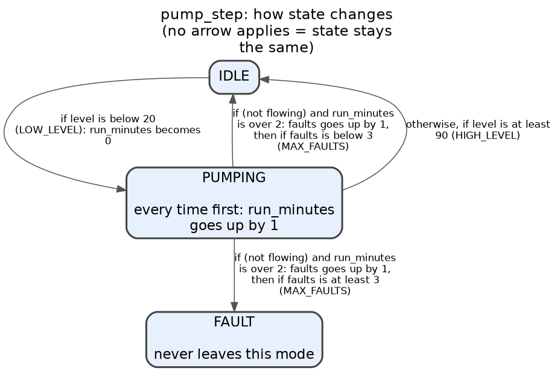
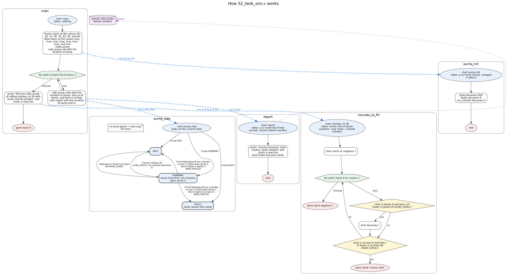
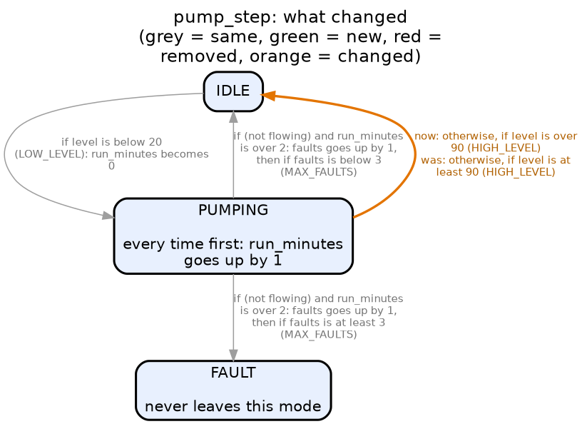

# Plainsight

**Check that code does what a person approved, without the person having to read the code.**

Plainsight reads C code (and, at an early level, C++ and Arduino sketches) and draws it as pictures. A person approves a **plan**, which is a picture of how the code *should* behave. Plainsight then runs the real, compiled code against that plan and reports every difference as a concrete example in plain words.

It is a command-line tool with **no AI inside it and no API keys**. It is built to be driven by an AI agent (Claude Code, Codex, a chat sandbox) while a person stays in charge of what gets built.

```
  plain words ──► plan (a picture) ──► a person says yes ──► code ──► check ──► report
                       ▲                                                          │
                       └────────────── fix the CODE, not the plan ◄──────────────┘
```

## Contents

- [Why it exists](#why-it-exists)
- [What it does](#what-it-does)
- [See it work](#see-it-work)
- [Install](#install)
- [Quick start](#quick-start)
- [Command reference](#command-reference)
- [Plans: how a person says what the code should do](#plans-how-a-person-says-what-the-code-should-do)
- [Approval](#approval)
- [Lock, diff and strength](#lock-diff-and-strength)
- [For AI agents](#for-ai-agents)
- [Why the reports can be trusted](#why-the-reports-can-be-trusted)
- [Limits](#limits)
- [Project layout](#project-layout)
- [Status](#status)
- [Background](#background)

## Why it exists

AI can write code in minutes. The slow, risky part is **trusting** it.

- A person who does not read code cannot review it.
- Tests written by the same AI that wrote the code can share its mistakes.
- Reading a step-by-step English translation of code turned out to be no easier for a non-coder than reading the code. What people could follow was a **picture** of the modes and arrows.

Plainsight moves the human step from "read the code" to "look at a picture and say yes". After that, everything is mechanical: the plan is turned into checks, the real code is run against them, and any difference comes back as an example you can read, such as *"In PUMPING, with level = 90, the plan says it goes to IDLE; the code stays in PUMPING."*

## What it does

Plainsight has three layers, plus two tools for edits.

| Layer | What it gives you | Main commands |
|---|---|---|
| **See** | Exact pictures, plain-English steps, summaries and facts (what each function reads, changes and calls) for existing C code | `plainsight FILE.c`, `--summary`, `--graph-out`, `--master`, `--facts` |
| **Approve** | A plan a person can read as a picture, checked for mistakes in the plan itself (a mode that can never be reached, an arrow that never fires), and stamped when approved | `plan-check`, `approve` |
| **Check** | The real code compiled and run against the plan on many inputs; differences reported as examples; standalone tests written from the plan | `check`, `--make-tests` |
| **Lock and diff** | What the code does *now*, saved; after any edit, exactly which behaviours changed, with red/green pictures | `snapshot`, `diff` |
| **Strength** | How good a plan is: small bugs are planted in the code and Plainsight reports which ones the plan would miss, and what to add | `strength` |

## See it work

The examples below come from the repo's own test files (a tank pump controller), so they are real output.

**A picture of one function.** `plainsight tests/golden/49_pump.c --graph-out pics` draws `pump_step` as a mode diagram: one box per mode, one arrow per change of mode, each labelled with its real condition.



**A plain-words summary of the same function.** `plainsight tests/golden/49_pump.c --summary`:

```
Function pump_step
  Takes: p (a Pump record, changed in place), level (whole number), flowing (truth value)
  What it does:
    Moves state between modes, depending on its current mode:
      In IDLE:
        - if level is below 20 (LOW_LEVEL): goes to PUMPING; run_minutes becomes 0
        - otherwise: it stays in IDLE
      In PUMPING:
        - every time, first: run_minutes goes up by 1
        - if (not flowing) and run_minutes is over 2: faults goes up by 1; then goes to FAULT if faults is at least 3 (MAX_FAULTS), otherwise to IDLE
        - otherwise, if level is at least 90 (HIGH_LEVEL): goes to IDLE
        - otherwise: it stays in PUMPING
      In FAULT:
        - nothing ever changes; it stays in FAULT
  Changes: only the record it's given (p).
```

**The whole program in one picture.** `plainsight FILE.c --master chart` puts every function's diagram in one chart. Dashed blue arrows show which function runs which; dotted purple arrows lead to shared variables. (Large programs, over 12 functions, get an overview with one box per function instead.)



**Checking code against an approved plan.** When the code matches:

```
$ plainsight check tests/golden/49_pump.c tests/check/pump_plan.mmd
Checking pump_step against the plan pump_plan.mmd
MATCHES: the code did exactly what the plan says in all 10368 tested cases (inputs around every number in the plan and the code).
```

When someone writes `level > HIGH_LEVEL` where the plan says "at least 90" (`pump_bug.c` is the same file with that one change; exit code 4):

```
$ plainsight check pump_bug.c tests/check/pump_plan.mmd
Checking pump_step against the plan pump_plan.mmd
DIFFERENT (10368 cases tested): 1 difference(s) found.

1. In PUMPING, with faults = 0, run_minutes = 0, level = 90, flowing = no:
  the plan says it goes to IDLE; the code stays in PUMPING.
  (plan line used: "otherwise, if level is at least 90")
  The same difference shows up in 180 of the 10368 tested cases.
```

**What an edit changed.** `plainsight diff old.c new.c --pictures pics` runs both versions on the same inputs. Orange is a changed arrow, green is new, red is removed, grey is unchanged.



## Install

You need:

| Requirement | Used for | Install (Debian/Ubuntu) |
|---|---|---|
| Python 3.10+ | running Plainsight (no pip dependencies) | usually already there |
| `clang` | reading C through its full syntax tree | `apt-get install -y clang` |
| `gcc` | compiling and running checks, examples and tests | `apt-get install -y gcc` |
| Graphviz (`dot`) | pictures (optional; text output works without it) | `apt-get install -y graphviz` |

```
apt-get install -y clang gcc graphviz
pip install .
plainsight doctor        # tells you what's missing and how to install it
```

On macOS: `brew install llvm graphviz` (and `xcode-select --install` for gcc). Tested on Linux (Ubuntu). Examples and timelines run each case in its own process with `fork`, so they need Linux or macOS. Windows has not been tried.

Without installing, run it from the repo folder with `python3 -m plainsight FILE.c`.

## Quick start

```
plainsight FILE.c                      # plain-English steps for every function
plainsight FILE.c --facts              # ...plus what each function reads, changes and calls
plainsight FILE.c --summary            # what each function does as a whole
plainsight FILE.c --graph-out pics     # a picture per function (.mmd .dot .svg .png)
plainsight FILE.c --master chart       # ONE picture of the whole program

plainsight check FILE.c plan.mmd       # does the code do what the approved plan says?
```

Arduino sketches (`.ino`) and C++ (`.cpp`, `.cc`, `.cxx`, `.hpp`) work the same way. Sketches are read with a stand-in for `Arduino.h`, so no hardware is involved.

## Command reference

| Command | What it does |
|---|---|
| `plainsight FILE.c` | Plain-English steps for every function, with a coverage line (`Covered: 8 of 8 statements`) |
| `... --facts` | Adds facts per function: side effects, shared variables read and changed, calls |
| `... --summary` | Rule-based summary per function (mode tables, "finds the first...", counts, sums). Where no rule fits, it shows the exact step instead |
| `... --graph` / `--graph-out DIR` | One diagram per function: a mode diagram for machines, a flowchart for everything else. Mermaid text plus Graphviz images |
| `... --master DIR` | One chart of the whole program |
| `... --json` | Everything as one JSON object, for other programs |
| `... --strict` | Exit code 3 if any part could not be described |
| `... -I DIR`, `-D NAME` | Include folders and defines for the C code |
| `plainsight guide` | Prints the plan language |
| `plainsight agent-guide` | Prints the step-by-step workflow for an AI agent |
| `plainsight names FILE.c` | The exact names a plan may use (fields, modes, inputs, constants) |
| `plainsight plan-check PLAN [--code FILE.c]` | Is the plan usable? Draws its picture and lists plan warnings |
| `plainsight approve PLAN --by NAME` | Records that a person looked at this exact plan and said yes |
| `plainsight check FILE.c PLAN [--make-tests OUT.c] [--json]` | Runs the real code against the plan. `PLAN` can also be a lock file |
| `plainsight snapshot FILE.c -o DIR` | Saves what the code does now as `NAME.lock` files (every tested case and its result) |
| `plainsight diff old.c new.c [--pictures DIR]` | Every behaviour change between two versions, as before/now examples |
| `plainsight strength FILE.c PLAN` | Plants bugs and reports which ones the plan would miss |
| `plainsight doctor` | What this machine has and what to install |

**Exit codes:** `0` fine, `1` file missing, `2` C does not compile (or the plan is unusable), `3` `--strict` and something is not yet supported, `4` the code differs from the plan (or `diff` found changes).

## Plans: how a person says what the code should do

A plan is written in the same words Plainsight uses in its own pictures, so a diagram Plainsight drew can be used as a plan. There are three kinds, and examples can be added to any of them. The full language is in [`plainsight/docs/PLAN_GUIDE.md`](plainsight/docs/PLAN_GUIDE.md) (or run `plainsight guide`).

**1. A machine with modes** (a Mermaid state diagram; shortened here, the full file is `tests/check/gate_plan.mmd`):

```
%% function: gate_tick
stateDiagram-v2
    CLOSED --> OPEN : if box_arrived and not bin_full: open_seconds becomes 0, blocked_seconds becomes 0
    OPEN --> JAMMED : if blocked_seconds is at least 5
    OPEN --> CLOSED : otherwise, if open_seconds is at least 3 and not sensor_blocked
    JAMMED --> CLOSED : if reset_pressed: jams goes up by 1
    note right of OPEN : every time first: open_seconds goes up by 1
```

**2. A plain function** (rules, checked top to bottom):

```
function: grade
if score plus bonus is at least 90: gives back 4
otherwise, if score plus bonus is at least 80: gives back 3
otherwise: gives back 0
```

**3. Examples** (any function: lists, text, printing, records):

```
function: minutes_to_fill
example: levels = [50, 18, 40, 70, 95], n = 5 -> gives back 3

function: greet
example: name = "Ana" -> prints "Hello, Ana!\n", greetings becomes 1
```

**Timelines** check behaviour over several calls in a row:

```
function: pump_step
timeline: p.state = IDLE | level = [15, 15, 50, 95], flowing = true -> p.state = [PUMPING, PUMPING, PUMPING, IDLE]
```

**How a plan is checked.** Mode diagrams and rules are tested on every mode and on inputs *around every number* in the plan and the code (for "at least 90": 89, 90 and 91), because that is where mistakes hide. Up to 20,000 cases are tried exhaustively; beyond that, a fixed-seed sample that still covers every value of every input is used. Examples test exactly what they show.

**Mistakes in the plan itself** are found before any code exists. Plainsight runs the plan step by step from its start mode and warns about modes that can never be reached, arrows that are never taken, and modes with no way out. On a first draft of a conveyor-gate plan it found that the JAMMED mode was impossible.

## Approval

`plainsight approve plan.mmd --by "NAME"` writes a small stamp (`plan.mmd.approved`) holding a SHA-256 fingerprint of the exact plan a person approved. Every later `check` reports one of:

- `Plan approved by NAME at TIME`
- `WARNING: no person has approved this plan yet`
- `WARNING: the plan CHANGED after NAME approved it`

The stamp is a **record, not a lock**: a program that ignores the rules could still run `approve`. The agent guide tells agents never to approve without a person's explicit yes.

## Lock, diff and strength

**Lock what the code does now.** `plainsight snapshot gate.c -o plans/` runs the code on thousands of inputs and saves every case and its result in `gate_tick.lock`. Approve it like any plan, then after every edit run `plainsight check gate.c gate_tick.lock`. A snapshot records what the code does, right or wrong, so approve it only if that is what it *should* do.

**See exactly what an edit changed.** `plainsight diff old.c new.c` compares two versions by behaviour, not by text: renaming variables or rewriting in another style shows up only if what the code *does* changed. Side-effect changes (a new shared variable written, a new call) are listed too. Pictures are drawn for machines simple enough to be shown as a mode diagram.

**Score a plan.** `plainsight strength FILE.c PLAN` plants small bugs in the function (a comparison moved to its neighbour, a number moved by one, `&&` and `||` swapped, a line skipped) and checks each against the plan the way real code is checked. A bug the plan doesn't notice "survived", and the report says what to add. On the pump:

```
$ plainsight strength tests/golden/49_pump.c tests/check/pump_plan.mmd
SCORE: 17 of 17 planted bugs noticed (100%)

$ plainsight strength tests/golden/49_pump.c tests/check/pump_timeline.plan
SCORE: 2 of 17 planted bugs noticed (12%)
3. line 4: HIGH_LEVEL changed from 90 to 89
   -> add an example right at HIGH_LEVEL (90) and one next to it
   (output abridged)
```

The second plan is the four-step timeline shown above (`tests/check/pump_timeline.plan`). It passes on correct code, and it also passes on code with `level > 90`, because none of its inputs sit at exactly 90. `strength` is how you find that out. Some surviving bugs make no real difference (`x > 2` and `x >= 3` on whole numbers), so 100% is not always possible.

## For AI agents

Plainsight makes **no AI calls**. In a sandbox the agent is the AI: it writes the plan and the code, and Plainsight checks them. Run `plainsight agent-guide` for the full workflow. In short:

1. `plainsight doctor`, then `plainsight guide` to learn the plan language.
2. Write the plan. If code exists, use its exact names (`plainsight names FILE.c`).
3. `plainsight plan-check plan.mmd --code FILE.c` until it says USABLE. Take plan warnings seriously.
4. **Show the person the picture and get an explicit yes**, then `plainsight approve plan.mmd --by "THEIR NAME"`. This is the one step the agent must not do alone.
5. Write the C code.
6. `plainsight check FILE.c plan.mmd --json`. If it says `different`, fix the **code**, not the plan. If the plan seems wrong, stop and ask, because a changed plan needs a new approval.
7. `plainsight check FILE.c plan.mmd --make-tests FILE_plan_tests.c` writes a standalone test file whose expected results come from the plan. Hand over the code, the approved picture, the tests, and the report's `not_checked` list.

`--json` output is available on `check`, `plan-check`, `names`, `diff`, `strength` and the default command.

## Why the reports can be trusted

- **It reads C the way the compiler does.** Code is read through clang's full JSON syntax tree, not by guessing from text, so operators, hidden conversions, macros and loop parts are stated, not inferred.
- **No AI in the core path.** The English, the pictures, the facts and the checks come from fixed rules. The same file always gives the same output.
- **It never guesses.** Anything it cannot describe exactly is shown in brackets (`[Not yet supported: goto statement (line 12)]`) and counted, never skipped silently. `--strict` turns any gap into an error.
- **It separates "yes" from "may".** A function that *may* change something through a pointer is never reported as "changes it" or as "changes nothing".
- **It runs the real code.** Checks compile your code with gcc and run it (mode and rule checks with the undefined-behaviour sanitizer on). Each example runs in its own process, so shared variables can't leak between examples and a crash fails only that example.
- **It says what it did not check.** Reports list what they could not cover, in a `Not checked:` line (changes through other pointers, what called functions do inside, printing, calls through function pointers).
- **It is tested against itself.** There are 369 tests. The main rules were proven by deliberately breaking them and confirming a test fails. 53 golden C files were reviewed line by line, and the checker is tested both ways: every planted mistake must be caught, and correct code written in a different style must not be flagged.
- **It has been run on real code.** On six open-source files (cJSON, linenoise, sds, jsmn, tiny-AES, sha256) it handled 271 functions with no crashes and described 94.6% of their statements. `python3 tools/corpus_census.py` repeats this and ranks what is still unsupported (`goto`, `++` inside larger expressions, unusual macros, calls through function pointers).

## Limits

- **Language.** C is the main target. C++ and Arduino are early: for example a C++ reference such as `Counter &` is shown as an unknown type.
- **What plans can test.** Mode diagrams and rules need inputs that are plain numbers or true/false. Lists, text, printing and records go in examples.
- **Examples only test what they show.** Use `strength` to find out what a plan would miss, and put examples exactly at each number that matters.
- **Testing is not proof.** Inputs are chosen around the numbers in the plan and the code. A bug that appears only for some other combination of values could be missed.
- **Function pointers can't be followed.** Reports always say so when a function makes such a call.
- **Diff pictures** are drawn only for machines simple enough to become a mode diagram. The text report works for every function that can be run.
- **Platforms.** Linux and macOS. Examples and timelines use `fork`.
- **Approval is a record, not a lock** (see [Approval](#approval)).
- **Not a substitute for professional sign-off.** Plainsight does not certify anything. Where a law requires a licensed engineer to review or seal a design, that requirement still applies.
- **Not yet tested with real users.** The picture-approval step was designed around feedback that step-by-step English was hard for a non-coder to follow, but it has not yet been user-tested with real people.

## Project layout

```
plainsight/            the tool
  cli.py               command line
  lift_json.py         reads C through clang's JSON syntax tree
  render.py            plain-English steps        summarize.py  rule-based summaries
  graph.py             mode diagrams + flowcharts master.py     one chart of a whole program
  facts.py             what each function reads / changes / calls
  plan.py              the plan language          plancheck.py  warnings about the plan itself
  planfile.py          plan validation + approval stamps
  check.py harness.py  run the real code against a plan
  examples.py          examples and timelines     maketests.py  standalone test files
  snapshot.py          locks and diffs            strength.py   planted-bug scoring
  lang.py              C / C++ / Arduino handling
  docs/                PLAN_GUIDE.md, AGENTS.md, the Arduino stand-in header
  _dictum/             two small files bundled from Dictum (see Background)
docs/images/           the pictures used in this README
tests/                 golden files, plans, and the test suite
tools/corpus_census.py runs Plainsight over real open-source C
PROJECT.md             design decisions and the full record of what was checked
```

Run the tests with `pip install pytest` and `python3 -m pytest tests/ -q` (needs gcc; the test run takes about a minute).

## Status

Working and tested: reading C, pictures, summaries, plans, checks, generated tests, approval stamps, snapshot/diff/strength, and the agent commands, all listed above.

Next steps that are not done yet:

- A real run of the agent workflow with an independent AI agent and a real person approving the picture. So far it has been exercised with scripted and in-sandbox runs.
- More of the unsupported C (`goto`, `++` inside larger expressions), and fuller C++.
- Ideas, not promises: running `check` on every commit in CI and posting the report as a comment; support for languages beyond C.

## Background

Created by jjsvg (GitHub: `jjohnco14-svg`) and built with AI agents: the code was written by Claude under the author's direction, and the tests exist to make that trustworthy.

Plainsight grew out of [Dictum](https://github.com/jjohnco14-svg/dictum_final), a natural-language-to-C compiler. It reuses Dictum's syntax-tree node types and type vocabulary (two small files, bundled in `plainsight/_dictum/` so Plainsight installs on its own; the copies in the Dictum repo are used when present).

`plainsight/snapshot.py` was rebuilt on 2026-09-27 after the original was accidentally overwritten. It follows the original's recorded outline and passes the original tests, but it is new code.

**License:** not yet chosen. Add a `LICENSE` file before others reuse the code.
